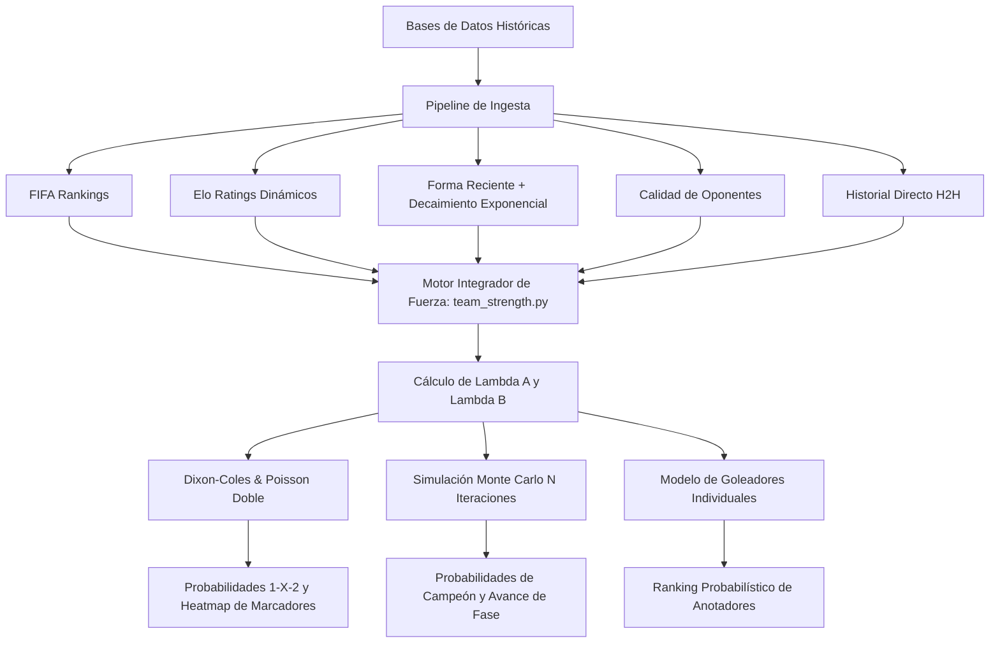

# 🏆 Predictor del Mundial — Monte Carlo & Advanced Statistical Engine

[](https://www.python.org/)
[](https://streamlit.io/)
[](https://github.com/Textualize/rich)
[](#licencia)
[](#)

Sistema avanzado de modelado estocástico, analítica deportiva y simulación de **Monte Carlo** para torneos de fútbol internacionales de alto rendimiento (Copa Mundial FIFA). Combina modelos estadísticos de **Dixon-Coles**, distribución bivariada de **Poisson**, sistema dinámico de **puntuación Elo**, decaimiento temporal exponencial de forma y calibración matemática por **Brier Score**.

Cuenta con una **interfaz gráfica web interactiva en Streamlit** con cuadro de eliminación directa dinámico (HTML/SVG), y un **CLI de consola ultrarrápido** con tablas formateadas y barras de progreso.

---

## 📖 Contenido
1. [Descripción General](#-descripción-general)
2. [Fundamentos Matemáticos y Arquitectura](#-fundamentos-matemáticos-y-arquitectura)
   - [Distribución de Poisson Doble](#1-distribución-de-poisson-doble)
   - [Modelo de Dixon-Coles y Ajuste de Marcadores Bajos](#2-modelo-de-dixon-coles-y-ajuste-de-marcadores-bajos)
   - [Sistema Elo Dinámico](#3-sistema-elo-dinámico)
   - [Decaimiento Temporal y Ponderación por Torneo](#4-decaimiento-temporal-y-ponderación-por-torneo)
   - [Calidad de Oponentes Enfrentados](#5-calidad-de-oponentes-enfrentados)
   - [Historial Directo (Head-to-Head)](#6-historial-directo-head-to-head)
   - [Tandas de Penales Estocásticas](#7-tandas-de-penales-estocásticas)
   - [Modelo Bayesiano de Goleadores Probables](#8-modelo-bayesiano-de-goleadores-probables)
3. [Características Principales](#-características-principales)
4. [Estructura del Proyecto](#-estructura-del-proyecto)
5. [Requisitos e Instalación](#-requisitos-e-instalación)
6. [Guía de Uso](#-guía-de-uso)
   - [Modo Web Interactivo (Streamlit)](#1-modo-web-interactivo-streamlit)
   - [Modo Línea de Comandos (CLI)](#2-modo-línea-de-comandos-cli)
   - [Lanzador Rápido para Windows (.bat)](#3-lanzador-rápido-para-windows-bat)
7. [Simulación de Monte Carlo del Torneo](#-simulación-de-monte-carlo-del-torneo)
8. [Calibración Matemática y Backtesting](#-calibración-matemática-y-backtesting)
9. [Compilación a Ejecutable Nativo (.exe)](#-compilación-a-ejecutable-nativo-exe)
10. [Licencia](#-licencia)

---

## 🧠 Descripción General

El **Predictor del Mundial** no se basa en heurísticas simplistas ni generadores aleatorios uniformes. Procesa décadas de registros de partidos internacionales oficiales (desde 1872 hasta el presente), clasificaciones mensuales de la FIFA y bases de datos detalladas de anotadores para modelar la probabilidad conjunta de cualquier encuentro.

El simulador permite:
- Modelar las intensidades ofensivas y defensivas ($\lambda_A$ y $\lambda_B$) para cada selección.
- Predecir las probabilidades de **Victoria Local (1), Empate (X) y Victoria Visitante (2)** con precisión decimal.
- Desplegar una matriz bidimensional (heatmap) de marcadores exactos ($0 \times 0$ hasta $5 \times 5$).
- Proyectar los goleadores más probables de cada selección con su probabilidad individual de gol.
- Ejecutar miles de simulaciones de Monte Carlo (desde 1 hasta 20,000 iteraciones) del cuadro eliminatorio completo (R32 $\to$ Final), actualizando probabilidades condicionales basadas en resultados reales ya disputados.

---

## 🧮 Fundamentos Matemáticos y Arquitectura



### 1. Distribución de Poisson Doble
El número de goles anotados por el Equipo A ($X$) y el Equipo B ($Y$) se modela como variables aleatorias de Poisson independientes con parámetros de intensidad $\lambda_A$ y $\lambda_B$:

$$P(X = x) = \frac{\lambda_A^x e^{-\lambda_A}}{x!}, \quad P(Y = y) = \frac{\lambda_B^y e^{-\lambda_B}}{y!}$$

### 2. Modelo de Dixon-Coles y Ajuste de Marcadores Bajos
La distribución de Poisson asume independencia estricta entre goles anotados por ambos equipos. Sin embargo, en el fútbol real los marcadores bajos ($0-0, 1-0, 0-1, 1-1$) presentan una dependencia táctica y psicológica correlacionada. 

Implementamos la corrección de **Dixon & Coles (1997)** aplicando una función de ajuste $\tau_{x,y}(\lambda_A, \lambda_B, \rho)$:

$$P(X = x, Y = y) = \tau_{x,y}(\lambda_A, \lambda_B, \rho) \cdot \frac{\lambda_A^x e^{-\lambda_A}}{x!} \cdot \frac{\lambda_B^y e^{-\lambda_B}}{y!}$$

Donde:
- Para $(0, 0)$: $\tau = 1 - \lambda_A \lambda_B \rho$
- Para $(1, 0)$: $\tau = 1 + \lambda_B \rho$
- Para $(0, 1)$: $\tau = 1 + \lambda_A \rho$
- Para $(1, 1)$: $\tau = 1 - \rho$
- Para cualquier otro marcador: $\tau = 1.0$

### 3. Sistema Elo Dinámico
El sistema calcula los ratings Elo continuos de cada selección tras cada partido disputado, ponderando la actualización según el factor de importancia del torneo ($K$):
- **Copa Mundial (Fase Final)**: $K = 60$
- **Torneos Continentales (Eurocopa, Copa América)**: $K = 50$
- **Eliminatorias Mundialistas**: $K = 40$
- **Partidos Amistosos**: $K = 20$

### 4. Decaimiento Temporal y Ponderación por Torneo
Los partidos recientes tienen un impacto significativamente mayor en la estimación de la forma actual que los jugados hace años. Se aplica una función de decaimiento exponencial con vida media configurable ($t_{1/2} = 365$ días):

$$w(t) = \exp\left( -\frac{\ln(2) \cdot \Delta t}{t_{1/2}} \right) \cdot w_{\text{torneo}}$$

Multiplicadores de torneo ($w_{\text{torneo}}$):
- **Copa Mundial (World Cup)**: $2.0\times$
- **Copa Continental / Clasificatorias**: $1.5\times$
- **Nations League**: $1.2\times$
- **Amistosos Internacionales**: $0.6\times$

### 5. Calidad de Oponentes Enfrentados
Una victoria frente a una selección del Top 5 mundial otorga sustancialmente más mérito en el cálculo de forma que una victoria frente a una selección de menor ranking. La métrica pondera el diferencial de ranking FIFA y rating Elo del rival en cada resultado de los últimos 24 meses.

### 6. Historial Directo (Head-to-Head)
Analiza el balance histórico específico entre las dos selecciones enfrentadas. Se consideran diferencias de goles, rachas y dominancias históricas, aplicando también decaimiento temporal para evitar que partidos de hace 50 años distorsionen el presente.

### 7. Tandas de Penales Estocásticas
Para encuentros eliminatorios que terminan en empate en tiempo regular o prórroga, el desenlace se modela mediante un enfoque híbrido:
- **Componente de Azar**: $70\%$ (alta varianza inherente a los penales).
- **Componente de Calidad**: $30\%$ derivado de la diferencia de calidad global de las plantillas y experiencia en tanda de penales.

### 8. Modelo Bayesiano de Goleadores Probables
Combina el historial histórico de goles internacionales por jugador, su tasa de goles por 90 minutos y la expectativa total de goles $\lambda$ de su selección en el encuentro específico, generando una distribución de probabilidad de que cada jugador anote al menos un gol.

---

## ✨ Características Principales

- 🖥️ **Dashboard Web en Streamlit (`app_streamlit.py`)**:
  - Cuadro visual eliminatorio completo (HTML5/SVG estilizado) con banderas, sedes y resultados en vivo.
  - Bloqueo y persistencia de partidos ya disputados en el torneo (R32, R16, Cuartos, Semifinales).
  - Selector inteligente de equipos que **filtra automáticamente las selecciones eliminadas**.
  - Simulación de Monte Carlo con control dual: **campo numérico manual (1 a 20,000)** y deslizador, con ejecución bajo demanda mediante botón.
  - Heatmap interactivo de resultados exactos ($0-0$ a $5-5$) y barras de probabilidad 1-X-2.
  - Proyección de los 10 anotadores más probables con cuotas estadísticas implícitas.
  - Panel lateral de sintonización en tiempo real para modificar los pesos matemáticos del modelo.
- ⚡ **CLI de Alto Rendimiento (`app.py`)**:
  - Interfaz interactiva de terminal basada en [Rich](https://github.com/Textualize/rich) con menús dinámicos, tablas a color y barras de progreso.
  - Modos de ejecución rápida mediante flags de consola (`--match`, `--tournament`, `--calibrate`).
- 🎯 **Motor de Calibración Automática**:
  - Backtesting histórico con las Copas del Mundo de 2018 y 2022.
  - Evaluación mediante **Brier Score** para encontrar los pesos que minimizan el error predictivo.
- 📦 **Totalmente Portable**:
  - Preparado para compilarse en un ejecutable `.exe` standalone mediante PyInstaller (`PredictorMundial.spec`).
  - Script de arranque rápido para Windows (`Predictor_Mundial_Grafico.bat`).

---

## 📂 Estructura del Proyecto

```text
📦 Mundial/
 ┣ 📂 data/                         # Conjuntos de datos históricos oficiales
 ┃ ┣ 📜 download_data.py            # Descarga y actualización automatizada de CSVs
 ┃ ┣ 📜 fifa_rankings.csv           # Historial oficial de posiciones y puntos FIFA
 ┃ ┣ 📜 goalscorers.csv             # Registro individual de goles y minutos internacionales
 ┃ ┗ 📜 results.csv                 # Más de 45,000 partidos internacionales (1872 - presente)
 ┣ 📂 model/                        # Arquitectura y modelos matemáticos
 ┃ ┣ 📜 __init__.py
 ┃ ┣ 📜 bracket_data.py             # Cuadro del torneo, resultados reales bloqueados y llaves
 ┃ ┣ 📜 calibration.py              # Motor de backtesting y optimización por Brier Score
 ┃ ┣ 📜 dixon_coles.py              # Modelo Dixon-Coles con corrección de dependencia baja
 ┃ ┣ 📜 elo_ratings.py              # Cálculo de ratings Elo dinámicos con factor K
 ┃ ┣ 📜 fifa_ranking.py             # Extracción e interpolación temporal de rankings FIFA
 ┃ ┣ 📜 historical_h2h.py           # Análisis de enfrentamientos directos cara a cara
 ┃ ┣ 📜 match_stats.py              # Proyección de tiros, corners, faltas y posesión
 ┃ ┣ 📜 monte_carlo.py              # Simulador estocástico iterativo (Poisson + Penales)
 ┃ ┣ 📜 opponent_quality.py         # Ponderación según ranking de los rivales superados
 ┃ ┣ 📜 team_strength.py            # Ensamble multivariable de parámetros de fuerza (Lambda)
 ┃ ┣ 📜 temporal_decay.py           # Funciones de decaimiento exponencial temporal
 ┃ ┗ 📜 top_scorers.py              # Modelo probabilístico bayesiano de goleadores
 ┣ 📂 visualization/                # Módulos gráficos y componentes visuales
 ┃ ┣ 📜 __init__.py
 ┃ ┣ 📜 html_bracket.py             # Generador del cuadro interactivo en SVG/HTML5
 ┃ ┣ 📜 probability_bars.py         # Gráfico de barras horizontales de 1-X-2
 ┃ ┣ 📜 probability_matrix.py       # Heatmap con escala de calor de marcadores exactos
 ┃ ┣ 📜 top_scores.py               # Visualización de los goleadores más probables
 ┃ ┗ 📜 tournament_bracket.py       # Generador de probabilidades de avance por fase
 ┣ 📜 app.py                        # Aplicación CLI con Rich
 ┣ 📜 app_streamlit.py              # Aplicación Web completa en Streamlit
 ┣ 📜 config.py                     # Configuración centralizada, hiperparámetros y llaves
 ┣ 📜 Predictor_Mundial_Grafico.bat # Lanzador de 1 clic para la interfaz gráfica
 ┣ 📜 PredictorMundial.spec         # Configuración de compilación con PyInstaller
 ┣ 📜 requirements.txt              # Dependencias oficiales de Python
 ┣ 📜 .gitignore                    # Reglas de exclusión de artefactos y binarios
 ┗ 📜 README.md                     # Documentación técnica completa
```

---

## 🛠️ Requisitos e Instalación

### 1. Prerrequisitos
- **Python**: Versión 3.9 o superior (probado hasta Python 3.14).
- **Git**: Para clonar y actualizar el repositorio.

### 2. Clonar el Repositorio
```bash
git clone https://github.com/cabezassebastian/predictor-mundial.git
cd predictor-mundial
```

### 3. Crear y Activar un Entorno Virtual (Opcional pero recomendado)
```bash
# En Windows (PowerShell)
python -m venv venv
.\venv\Scripts\Activate.ps1

# En Linux / macOS
python3 -m venv venv
source venv/bin/activate
```

### 4. Instalar Dependencias
```bash
pip install -r requirements.txt
```

Las dependencias principales son:
* `pandas` & `numpy`: Manipulación vectorial de datos y cálculos matriciales.
* `scipy`: Distribuciones estadísticas y optimización matemática.
* `matplotlib` & `seaborn`: Generación de gráficos analíticos y matrices de calor.
* `streamlit`: Framework reactivo para la interfaz de usuario web.
* `rich`: Renderizado estilizado en la terminal (tablas, banners, barras de progreso).
* `requests`: Descarga automática de datasets actualizados.

---

## 🚀 Guía de Uso

### 1. Modo Web Interactivo (Streamlit)

Inicia el servidor local de Streamlit ejecutando:
```bash
streamlit run app_streamlit.py
```
Se abrirá automáticamente en tu navegador predeterminado (por defecto en `http://localhost:8501`).

**Pestañas disponibles en la UI:**
1. **🏆 Cuadro y Simulación**:
   - Visualiza el bracket interactivo completo con banderas y resultados confirmados.
   - En la sección de **Monte Carlo**, ingresa el número deseado de iteraciones (ej. 5,000 o 20,000) y pulsa **"🚀 Iniciar Simulación Monte Carlo"**.
   - Consulta la tabla de probabilidades empíricas de cada equipo para llegar a Cuartos, Semis, Final y coronarse Campeón.
2. **⚽ Análisis de Partido**:
   - Selecciona los dos equipos a enfrentar (los menús desplegables solo listan selecciones activas).
   - Ajusta el número de simulaciones específicas para el encuentro.
   - Visualiza la distribución de probabilidad (Victoria Local / Empate / Victoria Visitante), el heatmap de marcadores y la tabla de goleadores proyectados.
3. **⚙️ Calibración**:
   - Ejecuta el backtesting sobre los mundiales pasados para evaluar el Brier Score de tus parámetros.

### 2. Modo Línea de Comandos (CLI)

Ejecuta el menú interactivo guiado:
```bash
python app.py
```

O utiliza los comandos directos por argumentos:
```bash
# Simular un partido individual entre dos selecciones (con 10,000 iteraciones)
python app.py --match "Spain" "Argentina" 10000

# Simular el torneo completo (Monte Carlo con 10,000 iteraciones)
python app.py --tournament 10000

# Ejecutar el análisis de calibración matemática
python app.py --calibrate
```

### 3. Lanzador Rápido para Windows (.bat)
Si estás en Windows, puedes simplemente hacer doble clic en el archivo:
```text
Predictor_Mundial_Grafico.bat
```
Este script verificará el entorno de Python, iniciará el servicio de Streamlit y levantará la ventana del navegador automáticamente.

---

## 📊 Simulación de Monte Carlo del Torneo

La simulación de Monte Carlo del torneo itera miles de veces sobre la estructura oficial del cuadro de eliminación directa:

1. **Partidos Bloqueados**: Cualquier partido con resultado oficial registrado en `model/bracket_data.py` (por ejemplo, resultados ya jugados de Cuartos o Semifinales) se respeta de manera determinista, garantizando que el simulador no contradiga la realidad.
2. **Partidos Futuros**: Los emparejamientos pendientes se resuelven mediante el cálculo estocástico de Poisson y Dixon-Coles en base a las intensidades $\lambda_A$ y $\lambda_B$ de los clasificados de cada rama.
3. **Métricas de Salida**: Al completar las $N$ iteraciones solicitadas, el sistema genera:
   - **Probabilidad de Semifinal**: Porcentaje de iteraciones en las que el equipo superó los Cuartos de Final.
   - **Probabilidad de Finalista**: Porcentaje de iteraciones en las que el equipo avanzó a la Gran Final.
   - **Probabilidad de Campeón**: Porcentaje de iteraciones en las que el equipo levantó la Copa del Mundo.

---

## 🔬 Calibración Matemática y Backtesting

Para garantizar la validez científica del modelo, el sistema cuenta con un motor de backtesting en `model/calibration.py`:

- **Partición Temporal**: El algoritmo retrocede el estado de los datos al instante previo al inicio de torneos pasados (como el Mundial 2018 o 2022), sin utilizar información futura (*leakage prevention*).
- **Métrica de Error**: Utiliza el **Brier Score** para probabilidades multiclase:

$$BS = \frac{1}{N} \sum_{i=1}^N \sum_{j=1}^R (p_{ij} - o_{ij})^2$$

Donde $p_{ij}$ es la probabilidad pronosticada para el resultado $j$ y $o_{ij} \in \{0, 1\}$ es el resultado real observado. Un Brier Score menor indica una calibración probabilística superior.

---

## 📦 Compilación a Ejecutable Nativo (.exe)

El proyecto incluye el archivo de especificación `PredictorMundial.spec` listo para compilar un ejecutable independiente para Windows sin necesidad de que el usuario final tenga Python instalado:

```bash
pip install pyinstaller
pyinstaller PredictorMundial.spec
```

El binario resultante se generará en la carpeta `dist/PredictorMundial.exe`.

---

## 📄 Licencia

Este proyecto está bajo la Licencia **MIT**. Puedes usarlo, modificarlo y distribuirlo libremente tanto para fines personales como académicos. Consulta el archivo de licencia para más detalles.
